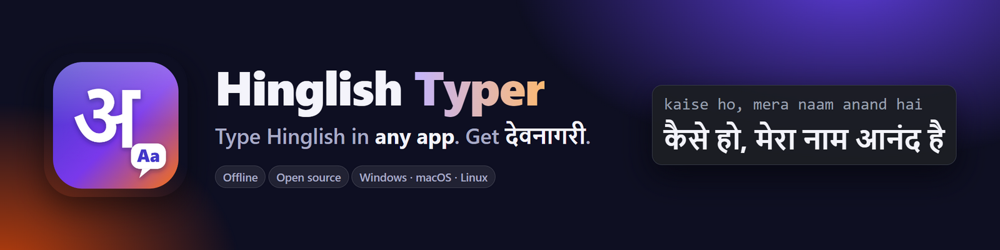
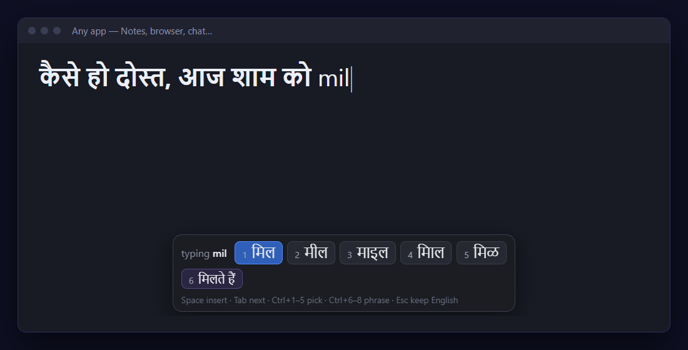
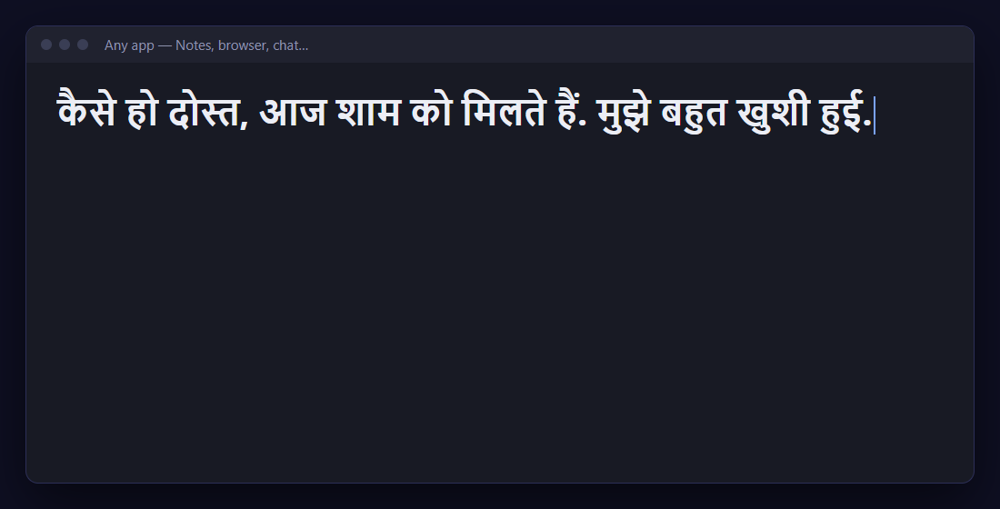
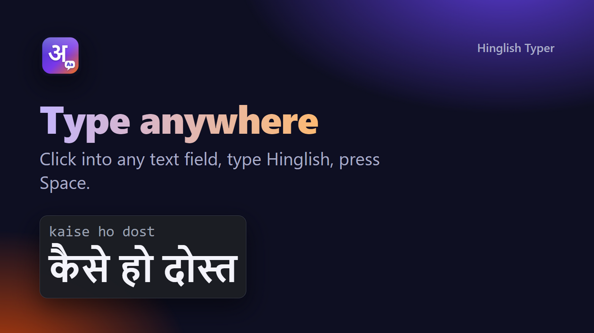
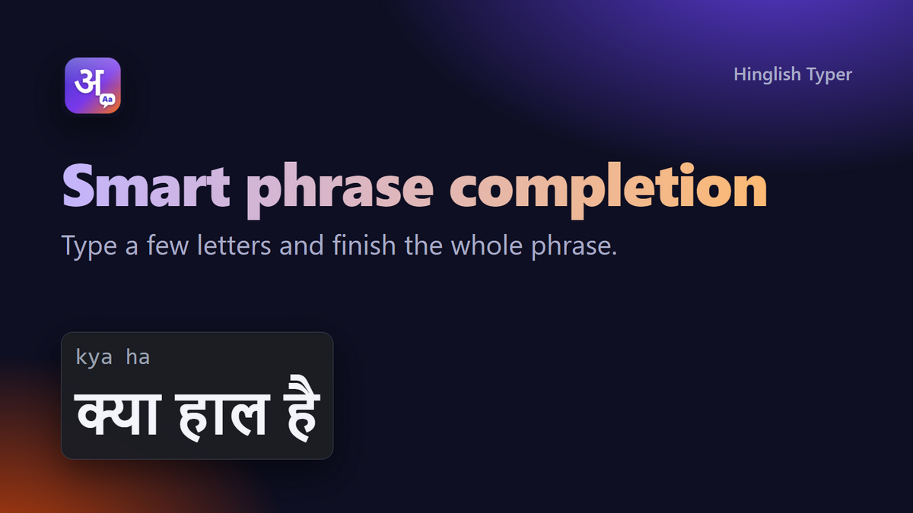
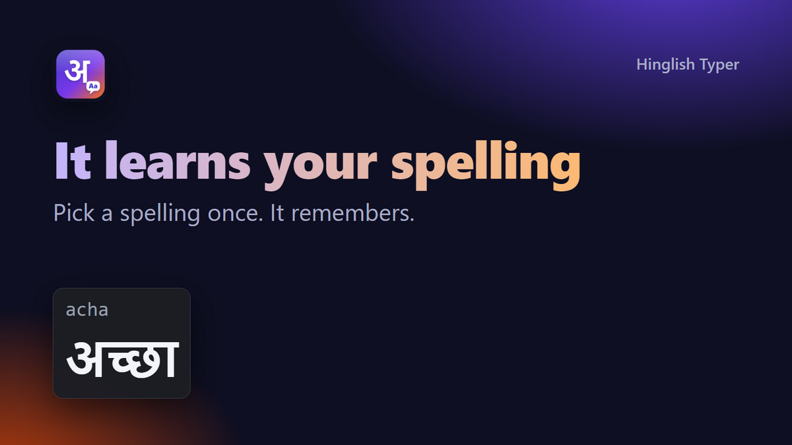
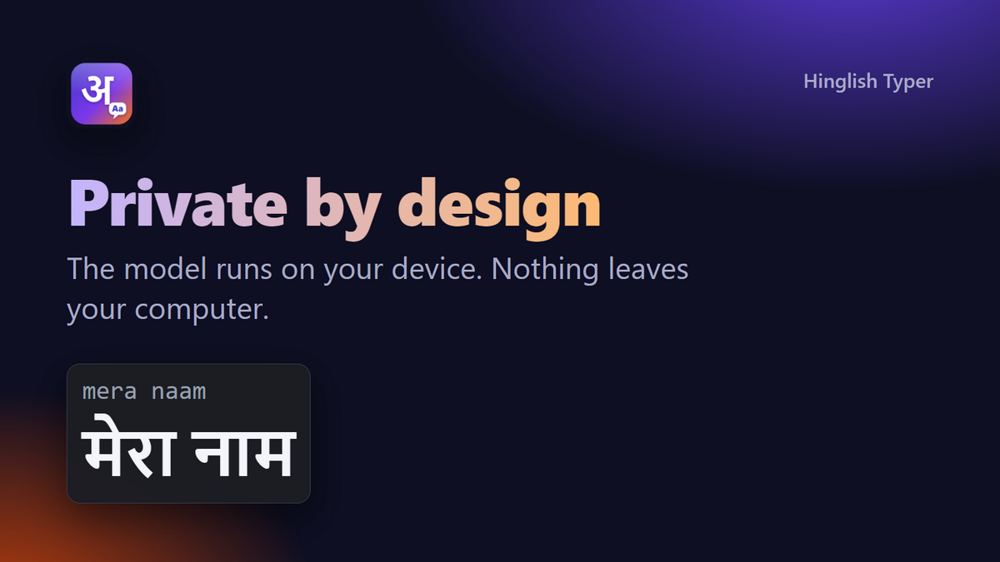

<p align="center"></p>

<p align="center">
  <a href="https://github.com/anand34577/hinglish-typer/releases/latest"></a>
  <a href="https://github.com/anand34577/hinglish-typer/actions/workflows/ci.yml"></a>
  <a href="LICENSE"></a>
  
</p>

# Hinglish Typer

Type Hinglish in **any app** on Windows, macOS or Linux and get Devanagari as you type: `kaise ho mera naam anand hai`
becomes `कैसे हो मेरा नाम आनंद है`. Works offline, nothing you type leaves your computer. It fills the gap left when
Google retired its Hindi input tools.

Transliteration is done by [**Lekhani**](https://udgamlabs.com/models/lekhani) by Udgam Labs (Apache-2.0), a 0.87 MB
model bundled in `lekhani/`. See [Credits](#credits).

## Download
Get the installer for your system from the [latest release](https://github.com/anand34577/hinglish-typer/releases/latest):
Windows `.exe`, macOS `.dmg` (Intel and Apple Silicon), Linux `.AppImage` / `.deb`. Builds are unsigned, so Windows
SmartScreen and macOS Gatekeeper will ask you to confirm the first launch. Checksums are in `SHA256SUMS.txt`.

Or run from source: `npm install && npm start`.

<p align="center"></p>

## Live typing
Switch on with **Ctrl+Shift+Space** (Cmd+Shift+Space on Mac) or the tray icon, click into any text field and type.
A bar near the bottom of the screen shows the Devanagari spellings of the word you are typing; when the word ends it is
replaced in the field.

| Key | Action |
|---|---|
| Space, `,` `.` `?` `!` | convert the word and continue |
| Enter | convert the word, then send Enter |
| Tab | next spelling |
| Ctrl+1..5 | pick that spelling |
| Ctrl+6..8 | pick a phrase completion (e.g. `kya ha` → क्या हाल है) |
| Esc | keep the word in English |

It learns: spellings you pick are remembered, and phrases you type often become suggestions (`prefs.json` in the app's
user-data folder). About 140 common Hinglish phrases are built in ([`phrases.json`](phrases.json)).

<p align="center"></p>

**Typing box** (Ctrl+Shift+H): a popup for composing longer text with a live preview; Enter pastes it into the app you
came from.

## Why it exists
Typing Devanagari on a desktop is awkward, and the older desktop input tools are gone. Hinglish Typer lets you
type the way you already do in chat and fixes it on the fly, anywhere, without sending your keystrokes to a server.

<table>
<tr><td></td><td></td></tr>
<tr><td></td><td></td></tr>
</table>

## FAQ
**Why is the download ~70–100 MB when the model is under 1 MB?** The model is tiny; the app shell is
[Electron](https://www.electronjs.org/), which bundles a whole browser engine. A much smaller native build (a few MB)
is on the [roadmap](#roadmap).

**Does it send what I type anywhere?** No. There are no network calls. Learned spellings stay in `prefs.json` locally.

**It picked the wrong spelling.** Press Tab (or Ctrl+1..5) before Space to choose another; it remembers your choice.

**It doesn't convert in some app.** Apps run as Administrator, games with their own input, and some remote desktops
block key hooks. Use the typing box (Ctrl+Shift+H) there.

## Roadmap
- [ ] Lightweight native build (Tauri) to cut installers from ~100 MB to a few MB
- [ ] Signed installers (Windows, macOS notarisation)
- [ ] Wayland support
- [ ] Other keyboard layouts
- [ ] Sentence-aware choices (main/mein) when a model supports it

## Platform notes
- Assumes a US-QWERTY layout. Live typing briefly shows the Latin letters, then swaps them for Devanagari by watching
  keys and pasting. It uses the clipboard and restores text you had copied.
- Windows: works out of the box; it can't type into windows running as Administrator unless it does too.
- macOS: allow Accessibility and Input Monitoring (System Settings → Privacy & Security).
- Linux: X11 only (the key hook does not work on Wayland); the typing box needs `xdotool`.
- Turn live typing off before typing passwords: the hook sees every key.
- Accuracy: Lekhani gets about two words in three exactly right and has no sentence context (`main` and `mein` both
  give में). Use Tab or Ctrl+1..5 to fix a word; it remembers.

## Development
```bash
npm install
npm test            # engine tests
npm start           # run the app
npm run icon        # re-render build/icon.png from tools/icon.svg
npm run art         # regenerate banner, promo images and screenshots in docs/
npm run dist        # build installers for the current OS into dist/
```
Screenshots and promo images are generated from the app's real UI and engine (`tools/`), not hand-drawn.
CI runs the tests on all three OSes. Pushing a tag `vX.Y.Z` that matches `package.json` builds installers on Windows,
macOS and Linux and publishes them, with checksums, to a GitHub Release (`.github/workflows/release.yml`).

## Credits
- **Lekhani**, Copyright 2026 Udgam Labs LLP: model, runner (Apache-2.0) and word list (CC0).
  <https://huggingface.co/udgamlabs/Lekhani>. Lekhani itself builds on AI4Bharat's Aksharantar, IndicXlit and
  IndicCorp v2, and the CMU Pronouncing Dictionary.
- [Electron](https://github.com/electron/electron) (MIT), [uiohook-napi](https://github.com/SnosMe/uiohook-napi) (MIT)
  with [libuiohook](https://github.com/kwhat/libuiohook) (LGPL-3.0).

Full details and licenses: [THIRD_PARTY_NOTICES.md](THIRD_PARTY_NOTICES.md). This project is licensed under
[Apache-2.0](LICENSE); see [NOTICE](NOTICE). Not affiliated with Udgam Labs or Google. Contributions welcome: see [CONTRIBUTING.md](CONTRIBUTING.md) and the [Code of Conduct](CODE_OF_CONDUCT.md); report security issues per [SECURITY.md](SECURITY.md).
